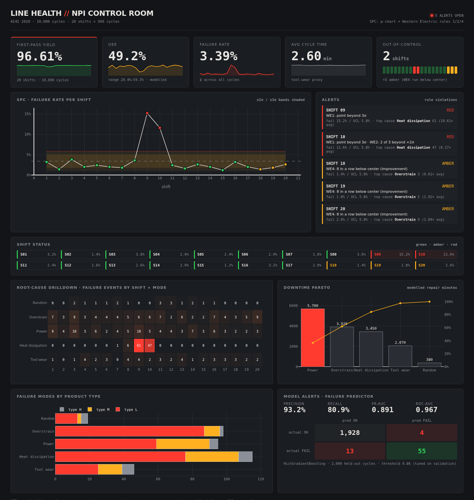
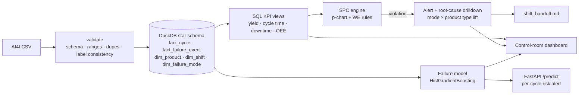

# Line Health — an NPI line-readiness control room



## The problem
When a new production line ramps up during NPI, the engineer on shift has to answer three questions fast:
**Is the line in control right now? If not, what's driving it? What does the next shift need to know?**
Raw sensor tables and month-end KPI decks don't answer those. This tool turns the cycle data into
**alerts → root cause → handoff** in one run.

The data is the public **AI4I 2020 Predictive Maintenance** dataset (UCI #601, CC BY 4.0): 10,000 machine cycles
with process sensors, product type (L/M/H) and five labelled failure modes. I treat each 500 consecutive cycles as one shift (20 shifts).

## Decisions and why

| Decision | Why |
|---|---|
| Watch **failure rate per shift on a p-chart** with **Western Electric rules 1, 2, 4**, not a fixed KPI threshold | During a ramp, "bad" means *unusual for this line*. Rules 1/2 catch spikes, rule 4 catches a sustained drift either way. |
| A run of 8 shifts **below** center is **amber, not red** | It's an improvement, but it still means the process changed. The right move is to confirm what changed and re-baseline the limits, not to page someone. |
| Every alert carries a **root-cause drilldown** (failure mode × product type, with lift against an average shift) | An alert without a likely cause just adds to the queue. |
| Output is a **markdown shift handoff** (`reports/shift_handoff.md`), not just a chart | Handoffs happen in chat and tickets, not in dashboards. |
| Failure predictor is judged on **PR-AUC and precision/recall**, with the alert threshold tuned on a validation split | Failures are 3.4% of cycles, so accuracy and ROC alone hide false-alarm fatigue. |
| **DuckDB star schema** + SQL KPI views | Every number on the dashboard can be traced back to one SQL view, and the whole thing runs on a laptop with no server. |
| Validate before load and **report** inconsistencies instead of silently dropping them | 27 rows have a failure flag that disagrees with their mode flags. That's a data-quality finding, not noise. |

## Architecture


## Results (from the actual run)
**What the line-health flow caught**
- **2 red alerts: shifts 9 and 10** (WE1, and WE2 on shift 10). Failure rate was 15.2% and 11.6% against a UCL of 5.8%, and yield fell to 84.8% / 88.4%.
- **Root cause: heat dissipation failures.** There were 61 and 47 in those two shifts, 10.6× and 8.2× an average shift, which is 108 of all 115 HDF events in the dataset. The handoff tells the next shift to inspect heat dissipation first. Product type L made up 55 of shift 9's 81 failure events.
- **3 amber alerts: shifts 18–20** (WE4, a sustained run below center). The process got better, and the handoff asks to confirm what changed before re-baselining.

**Line KPIs (20 shifts)**: first-pass yield **96.61%**, failure rate p̄ **3.39%**, OEE **49.2%** (range 20.4–59.3%), average cycle time **2.60 min**.
Yield differs by product type (χ² = 13.75, p = 0.001: L 96.1%, M 97.2%, H 97.9%), but torque does not (ANOVA p = 0.88).
Failed cycles run at higher torque (median 53.7 vs 39.9 Nm) and higher tool wear (165 vs 107 min), Mann-Whitney p < 1e-23.
By modelled repair minutes, power failures lead the downtime Pareto (5,700 min from 95 events).

**Per-cycle failure predictor (2,000 held-out cycles)**

| Model | ROC-AUC | PR-AUC | Precision | Recall | F1 |
|---|---|---|---|---|---|
| Logistic regression baseline | 0.931 | 0.473 | 17.3% | 85.3% | 0.287 |
| HistGradientBoosting (t = 0.86) | **0.967** | **0.891** | **93.2%** | **80.9%** | **0.866** |

55 of 68 failures caught with 4 false alarms. It's served at `POST /predict`, with validated inputs and a 422 response on bad input.

## What's measured vs. modelled
The source data has no timestamps or repair logs. **Measured**: yield, failure counts, SPC alerts, statistical tests, model metrics.
**Modelled** (see `config.py`): the shift is 500 cycles, cycle time is estimated from tool-wear increments, downtime uses assumed repair minutes per mode, and OEE is built from those.
AI4I is synthetic but realistic data, so expect lower model scores on a real line.

## Run it
```bash
make all          # env → data → pipeline → SPC/alerts → model → dashboard → tests (6 passing)
make handoff      # print the shift handoff report
make serve        # FastAPI on :8000
make screenshot   # re-render reports/figures/dashboard.png (1440 px)
```
Outputs: `reports/dashboard.html`, `reports/shift_handoff.md`, `reports/line_health.json`, `reports/stats.json`, `reports/model_metrics.json`.
